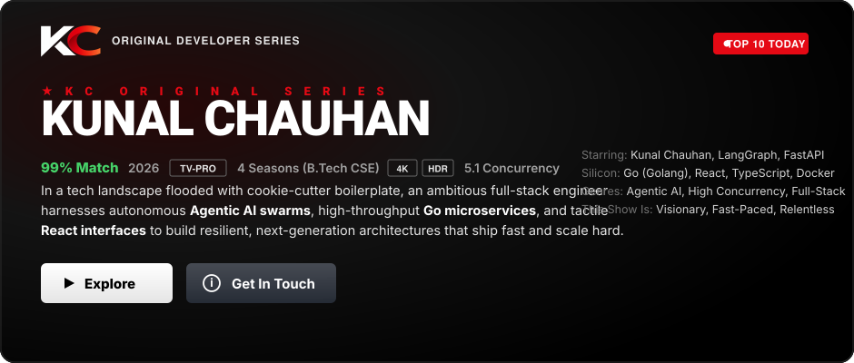

<div align="center">

  <!-- ============================================== -->
  <!-- 🍿 NETFLIX ORIGINAL BILLBOARD HERO             -->
  <!-- ============================================== -->
  

  <br><br>

  <!-- Netflix Dynamic Stream Tagline -->
  <a href="https://github.com/burgerbeast7">
    
  </a>

  <br><br>

  <!-- Netflix Badges -->
  <p align="center">
    <a href="https://komarev.com/ghpvc/?username=burgerbeast7">
      
    </a>
    &nbsp;
    <a href="https://linkedin.com/in/kunal-chauhan-7a7539287" target="_blank">
      
    </a>
    &nbsp;
    <a href="mailto:kunalchauhan91837@gmail.com">
      
    </a>
    &nbsp;
    <a href="https://instagram.com/Kunal.3.6.3.4" target="_blank">
      
    </a>
    &nbsp;
    
  </p>

</div>

<p align="center">
  
</p>

<!-- ============================================== -->
<!-- 👤 WHO'S WATCHING? (NETFLIX PROFILE PICKER)    -->
<!-- ============================================== -->
<div align="center">
  
</div>

<br>

<div align="center">
  <p>
    <b>Choose your viewing experience:</b><br>
    🔴 <b>Recruiter:</b> Fast-track to the <a href="#-top-10-in-tech-today-trending-projects">Top 10 Flagship Projects</a> and hire Kunal.<br>
    🔵 <b>Tech Lead:</b> Dive into microsecond <a href="https://github.com/burgerbeast7/ATLAS">Golang Concurrency</a> and API architecture.<br>
    🟢 <b>AI Explorer:</b> Binge <a href="https://github.com/burgerbeast7/careerpilot-ai">Agentic Multi-Agent LangGraph Swarms</a>.<br>
    ⚪ <b>Collaborator:</b> Jump to the <a href="#-ready-to-watch-create-your-collaboration">Contact Section</a> to start a project.
  </p>
</div>

<p align="center">
  
</p>

<!-- ============================================== -->
<!-- 🏆 TOP 10 IN TECH TODAY (FEATURED TITLES)      -->
<!-- ============================================== -->
### 🏆 Top 10 in Tech Today (Trending Projects)

<p><i>The most-watched repositories in Kunal's catalog, ranked by engineering complexity:</i></p>

<table>
  <tr>
    <td width="50%" valign="top">
      <h3 align="center">🥇 #1 in Trending: CareerPilot AI</h3>
      <p align="center">
        <a href="https://github.com/burgerbeast7/careerpilot-ai">
          
        </a>
      </p>
      <p>
        <b>Logline:</b> <i>When 90% of resumes vanish into ATS filters, an autonomous multi-agent swarm steps in to rewrite the game.</i><br>
        Features semantic RAG resume intelligence, automated gap analysis, and interactive mock interview coaching.
      </p>
      <p>
        <code>TypeScript</code> • <code>React</code> • <code>FastAPI</code> • <code>LangGraph</code> • <code>RAG</code>
      </p>
    </td>
    <td width="50%" valign="top">
      <h3 align="center">🥈 #2 in Machine Learning: ModelBench AI</h3>
      <p align="center">
        <a href="https://github.com/burgerbeast7/ModelBench-AI">
          
        </a>
      </p>
      <p>
        <b>Logline:</b> <i>Ending the chaotic era of messy Jupyter notebooks and manual spreadsheet tracking.</i><br>
        A studio-grade benchmarking arena comparing classification and regression models side-by-side with interactive metric dashboards and reusable ML pipelines.
      </p>
      <p>
        <code>Python</code> • <code>Machine Learning</code> • <code>Scikit-Learn</code> • <code>Data Pipelines</code>
      </p>
    </td>
  </tr>
  <tr>
    <td width="50%" valign="top">
      <h3 align="center">🥉 #3 in High Concurrency: ATLAS Engine</h3>
      <p align="center">
        <a href="https://github.com/burgerbeast7/ATLAS">
          
        </a>
      </p>
      <p>
        <b>Logline:</b> <i>When raw speed matters, Go's goroutines deliver pure computational adrenaline.</i><br>
        Engineered with Golang lightweight concurrency channels and zero-allocation pipelines to handle intense workloads with microsecond latency.
      </p>
      <p>
        <code>Go (Golang)</code> • <code>Concurrency</code> • <code>High Performance</code> • <code>Systems Design</code>
      </p>
    </td>
    <td width="50%" valign="top">
      <h3 align="center">🎬 #4 in Enterprise: Greyquill Entity Resolution</h3>
      <p align="center">
        <a href="https://github.com/burgerbeast7/greyquill-entity-resolution">
          
        </a>
      </p>
      <p>
        <b>Logline:</b> <i>Untangling enterprise customer chaos without resorting to unexplainable black-box AI.</i><br>
        Custom record-linkage algorithms with explainable similarity scoring to detect duplicate records across noisy real-world customer datasets.
      </p>
      <p>
        <code>Python</code> • <code>Record Linkage</code> • <code>Similarity Scoring</code> • <code>Data Hygiene</code>
      </p>
    </td>
  </tr>
  <tr>
    <td width="50%" valign="top">
      <h3 align="center">🎬 #5 in Smart City: SmartPark AI</h3>
      <p align="center">
        <a href="https://github.com/burgerbeast7/SmartPark-AI">
          
        </a>
      </p>
      <p>
        <b>Logline:</b> <i>A modern thriller: 20 minutes spent circling a packed parking lot, solved in seconds.</i><br>
        Cross-platform mobile client featuring real-time bay occupancy telemetry, cloud synchronization, and automated slot reservations.
      </p>
      <p>
        <code>Dart</code> • <code>Flutter</code> • <code>TypeScript</code> • <code>Mobile Cloud APIs</code>
      </p>
    </td>
    <td width="50%" valign="top">
      <h3 align="center">🎬 #6 in Campus Life: HPTU Assistant (ASIST)</h3>
      <p align="center">
        <a href="https://github.com/burgerbeast7/HPTU-ASIST">
          
        </a>
      </p>
      <p>
        <b>Logline:</b> <i>The definitive survival series for college students staring down finals week.</i><br>
        Centralized portal for students at HPTU Hamirpur to access syllabus syllabi, semester notes, academic notifications, and utility calculators.
      </p>
      <p>
        <code>Python</code> • <code>Full-Stack</code> • <code>Campus Utilities</code> • <code>Student Tooling</code>
      </p>
    </td>
  </tr>
</table>

<br>
<p align="center">
  
</p>

<!-- ============================================== -->
<!-- 📺 CONTINUE WATCHING (TECH STACK & GENRES)     -->
<!-- ============================================== -->
### 📺 Continue Watching for Kunal (Tech Categories)

<div align="center">

| Genre / Category | Cast &amp; Technologies |
| :--- | :--- |
| **Critically Acclaimed Languages** | `Python 3.12` `Go (Golang)` `TypeScript` `JavaScript` `Dart` `C` `C++` `SQL` |
| **Sci-Fi &amp; Neural Intelligence** | `LangGraph` `Multi-Agent Swarms` `RAG Workflows` `PyTorch` `Vector DBs` |
| **Binge-Worthy Frontend** | `React 19` `Next.js` `Redux Toolkit` `TailwindCSS` `Framer Motion` `Vite` |
| **High-Adrenaline APIs &amp; Backends** | `FastAPI (ASGI)` `Go Channels` `Django` `Node.js` `WebSockets` `Redis` |
| **Data Vaults &amp; Architecture** | `PostgreSQL` `MongoDB` `Redis Cache` `SQLite` `Prisma ORM` |
| **Production Infrastructure** | `Docker Containers` `AWS (EC2, S3)` `Linux (Bash)` `GitHub Actions CI/CD` |

<br>

<!-- Netflix Dark Skill Matrix Ribbon -->
<a href="https://skillicons.dev">
  
</a>

</div>

<br>
<p align="center">
  
</p>

<!-- ============================================== -->
<!-- 🎞️ SEASONS & EPISODES (DEVELOPER TIMELINE)     -->
<!-- ============================================== -->
### 🎞️ Episodes &amp; Seasons Guide

```text
Season 1: The Foundations (2022 - 2023)
├── Ep 1: "Hello World" — Conquering C/C++, Memory Models & Low-Level Algorithms.
└── Ep 2: Object-Oriented Principles, Linux Environments, and Core Problem Solving.

Season 2: The Full-Stack Awakening (2023 - 2024)
├── Ep 3: First Reactive UIs with React, REST APIs, and Responsive Design.
└── Ep 4: Python Ecosystem Deep-Dive, Database Modeling (PostgreSQL), and Docker Isolation.

Season 3: The High-Throughput Arc (2024 - 2025)
├── Ep 5: Falling in Love with Golang — Goroutines, Channels, and Microsecond APIs.
└── Ep 6: The AI Frontier — Transitioning from simple prompts to autonomous LangGraph Swarms.

Season 4: The Season Finale (2025 - 2026) [CURRENTLY AIRING]
├── Ep 7: Final Year CSE @ HPTU Hamirpur & Shipping CareerPilot AI to production.
└── Ep 8: The Next Series — Ready to join a visionary team as an AI / Full-Stack Engineer.
```

<br>
<p align="center">
  
</p>

<!-- ============================================== -->
<!-- 📈 STREAM TELEMETRY & RATINGS                  -->
<!-- ============================================== -->
### 📈 Live Telemetry &amp; Critical Acclaim

<div align="center">

  <!-- Main GitHub Stats & Streak Stats -->
  <p align="center">
    
    &nbsp;
    
  </p>

  <!-- Top Languages Compact -->
  <p align="center">
    
  </p>

  <br>

  <!-- Dev Quote Card -->
  

</div>

<br>
<p align="center">
  
</p>

<!-- ============================================== -->
<!-- ❓ FREQUENTLY ASKED QUESTIONS (NETFLIX ACCORDION)-->
<!-- ============================================== -->
### ❓ Frequently Asked Questions

<details>
  <summary><b>▶ What is Kunal Chauhan?</b></summary>
  <br>
  <p>Kunal is a final-year Computer Science &amp; Engineering undergrad at <b>HPTU Hamirpur</b>, specializing in architecting <b>Agentic AI systems (LangGraph)</b>, high-concurrency backends in <b>Go &amp; FastAPI</b>, and fluid user interfaces in <b>React &amp; TypeScript</b>.</p>
</details>

<details>
  <summary><b>▶ How much does it cost to hire or collaborate with Kunal?</b></summary>
  <br>
  <p>Zero subscription fees. Available for high-impact full-time software engineering roles, internships, and collaborative builds with teams pushing the boundaries of AI and scalable systems.</p>
</details>

<details>
  <summary><b>▶ Where can I watch his code in action?</b></summary>
  <br>
  <p>Right here on GitHub! Every repository in the catalog features clean modular architecture, full documentation, and reproducible code.</p>
</details>

<details>
  <summary><b>▶ What devices are supported?</b></summary>
  <br>
  <p>Cross-platform compatibility across Chrome, Safari, Firefox, Linux CLI, Docker containers, and macOS / Windows workstations.</p>
</details>

<br><br>

<!-- ============================================== -->
<!-- 🎬 READY TO WATCH? (NETFLIX CTA FOOTER)        -->
<!-- ============================================== -->
<div align="center">

  <h3>Ready to start streaming?</h3>
  <p>Connect to collaborate, hire, or discuss next-generation software architecture.</p>

  <p align="center">
    <a href="https://linkedin.com/in/kunal-chauhan-7a7539287" target="_blank">
      
    </a>
    &nbsp;&nbsp;
    <a href="mailto:kunalchauhan91837@gmail.com">
      
    </a>
    &nbsp;&nbsp;
    <a href="https://instagram.com/Kunal.3.6.3.4" target="_blank">
      
    </a>
  </p>

  <br>
  <p align="center">
    <br>
    <small style="color: #737373;">
      NETFLIX and the N Logo are trademarks of Netflix, Inc. This profile is a creative developer tribute portfolio.<br>
      © 2026 Kunal Chauhan (@burgerbeast7) • Palampur, Himachal Pradesh.
    </small>
  </p>

</div>
