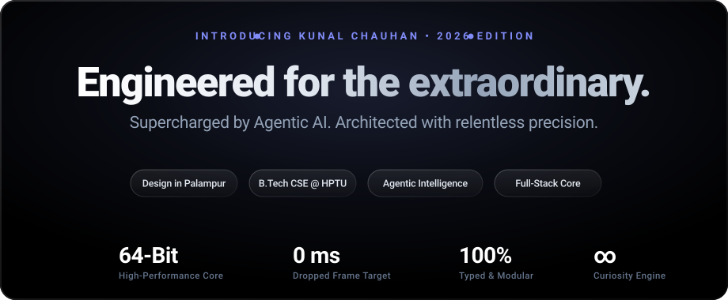
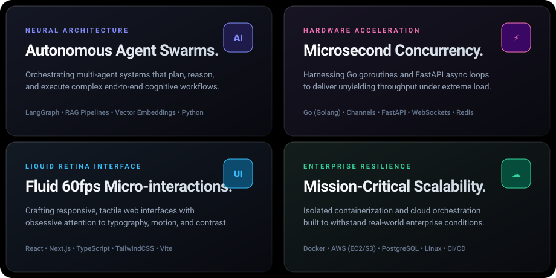

<div align="center">

  <!-- ============================================== -->
  <!--  APPLE KEYNOTE HERO BANNER                   -->
  <!-- ============================================== -->
  

  <br><br>

  <!-- Dynamic Typography / Tagline -->
  <a href="https://github.com/burgerbeast7">
    
  </a>

  <br><br>

  <!-- Minimalist Apple Product Badges -->
  <p align="center">
    <a href="https://komarev.com/ghpvc/?username=burgerbeast7">
      
    </a>
    &nbsp;
    <a href="https://linkedin.com/in/kunal-chauhan-7a7539287" target="_blank">
      
    </a>
    &nbsp;
    <a href="mailto:kunalchauhan91837@gmail.com">
      
    </a>
    &nbsp;
    <a href="https://instagram.com/Kunal.3.6.3.4" target="_blank">
      
    </a>
    &nbsp;
    
  </p>

</div>

<p align="center">
  
</p>

<!-- ============================================== -->
<!-- 📦 WHAT'S IN THE BOX (UNBOXING EXPERIENCE)     -->
<!-- ============================================== -->
### 📦 What’s in the Box.

> *Tear the pull tab. Lift the lid. Experience immediate power from the moment you clone the repository.*

```text
┌────────────────────────────────────────────────────────────────────────┐
│  PACKAGE CONTENTS:                                                     │
│                                                                        │
│  ├── 1x Kunal Chauhan (Pro Developer Unit — Space Black finish)        │
│  ├── 1x Neural Agentic Core (LangGraph • RAG • Vector Intelligence)    │
│  ├── 1x High-Velocity Compute Engine (Go • FastAPI • Async Concurrency)│
│  ├── 1x Liquid Retina Frontend Layer (React • Next.js • TypeScript)    │
│  ├── 1x Enterprise Cloud Architecture (Docker • AWS • CI/CD)           │
│  └── 1x Infinite USB-C Mountain Brew Cable (Provides all-day focus)    │
│                                                                        │
│  *Documentation: Zero bloat. Fully typed, self-documenting code inside.│
└────────────────────────────────────────────────────────────────────────┘
```

---

<!-- ============================================== -->
<!-- 🎛️ APPLE BENTO ARCHITECTURE GRID              -->
<!-- ============================================== -->
<div align="center">
  
</div>

<br>
<p align="center">
  
</p>

<!-- ============================================== -->
<!-- 🔬 TECHNICAL SPECIFICATIONS (SPEC SHEET)       -->
<!-- ============================================== -->
### 🔬 Technical Specifications.

<div align="center">

| Component | Architecture &amp; Capabilities |
| :--- | :--- |
| **Silicon Architecture** | `Python 3.12` `Go (Golang)` `TypeScript` `JavaScript` `Dart` `C / C++` `SQL` |
| **Neural Engine (AI)** | `LangGraph` `Multi-Agent Orchestration` `RAG Pipelines` `PyTorch` `Vector DBs` |
| **Display Technology** | `React 19` `Next.js` `Redux Toolkit` `TailwindCSS` `Sub-pixel Precision` |
| **High-Throughput APIs** | `FastAPI (ASGI)` `Go Goroutines & Channels` `WebSockets` `Redis Cache` |
| **Data Persistence** | `PostgreSQL` `MongoDB` `Redis` `SQLite` `Prisma ORM` |
| **Cloud &amp; Infrastructure** | `Docker Isolation` `AWS (EC2, S3)` `Linux Kernel` `GitHub Actions CI/CD` |
| **Thermal &amp; Power** | High sustained performance under extreme 2 AM debugging sessions |

<br>

<!-- Minimalist Dark Skill Matrix Ribbon -->
<a href="https://skillicons.dev">
  
</a>

</div>

<br>
<p align="center">
  
</p>

<!-- ============================================== -->
<!-- 🚀 THE PRO LINEUP (FLAGSHIP PROJECTS)          -->
<!-- ============================================== -->
### 🚀 The Flagship Lineup.

<p><i>Every product in the lineup is precision-engineered to solve complex architectural challenges:</i></p>

<table>
  <tr>
    <td width="50%" valign="top">
      <h3 align="center">CareerPilot AI</h3>
      <p align="center">
        <a href="https://github.com/burgerbeast7/careerpilot-ai">
          
        </a>
      </p>
      <p>
        <b>The Autonomous Career Intelligence Platform.</b><br>
        Engineered with a multi-agent orchestration core to eliminate resume filtering barriers. Employs semantic RAG intelligence, automated gap analysis, and interactive mock interview simulation.
      </p>
      <p>
        <code>TypeScript</code> • <code>React</code> • <code>FastAPI</code> • <code>LangGraph</code> • <code>RAG</code>
      </p>
    </td>
    <td width="50%" valign="top">
      <h3 align="center">ModelBench AI</h3>
      <p align="center">
        <a href="https://github.com/burgerbeast7/ModelBench-AI">
          
        </a>
      </p>
      <p>
        <b>Studio-Grade Machine Learning Benchmarking.</b><br>
        A unified evaluation arena comparing classification and regression models side-by-side with interactive telemetry dashboards, metrics visualization, and reusable ML pipelines.
      </p>
      <p>
        <code>Python</code> • <code>Machine Learning</code> • <code>Scikit-Learn</code> • <code>Data Pipelines</code>
      </p>
    </td>
  </tr>
  <tr>
    <td width="50%" valign="top">
      <h3 align="center">ATLAS Engine</h3>
      <p align="center">
        <a href="https://github.com/burgerbeast7/ATLAS">
          
        </a>
      </p>
      <p>
        <b>Microsecond Concurrency in Go.</b><br>
        Built from the silicon up in Golang. Leverages lightweight goroutines, channels, and zero-allocation pipelines to achieve extreme throughput with minimal system footprint.
      </p>
      <p>
        <code>Go (Golang)</code> • <code>Concurrency</code> • <code>High Performance</code> • <code>Systems Design</code>
      </p>
    </td>
    <td width="50%" valign="top">
      <h3 align="center">Greyquill Entity Resolution</h3>
      <p align="center">
        <a href="https://github.com/burgerbeast7/greyquill-entity-resolution">
          
        </a>
      </p>
      <p>
        <b>Explainable Record Deduplication.</b><br>
        Engineered for enterprise data hygiene. Features custom mathematical similarity algorithms that detect customer duplicate records across noisy real-world datasets with full explainability.
      </p>
      <p>
        <code>Python</code> • <code>Record Linkage</code> • <code>Similarity Scoring</code> • <code>Data Hygiene</code>
      </p>
    </td>
  </tr>
  <tr>
    <td width="50%" valign="top">
      <h3 align="center">SmartPark AI</h3>
      <p align="center">
        <a href="https://github.com/burgerbeast7/SmartPark-AI">
          
        </a>
      </p>
      <p>
        <b>Intelligent Urban Mobility.</b><br>
        Eliminates urban parking friction with cross-platform mobile connectivity, real-time bay occupancy telemetry, and instant slot reservations.
      </p>
      <p>
        <code>Dart</code> • <code>Flutter</code> • <code>TypeScript</code> • <code>Mobile Cloud APIs</code>
      </p>
    </td>
    <td width="50%" valign="top">
      <h3 align="center">HPTU Assistant (ASIST)</h3>
      <p align="center">
        <a href="https://github.com/burgerbeast7/HPTU-ASIST">
          
        </a>
      </p>
      <p>
        <b>Academic Intelligence for Higher Education.</b><br>
        Developed for students at HPTU Hamirpur to consolidate semester resources, syllabus syllabi, academic notifications, and utility calculators into an intuitive portal.
      </p>
      <p>
        <code>Python</code> • <code>Full-Stack</code> • <code>Campus Utilities</code> • <code>Student Tooling</code>
      </p>
    </td>
  </tr>
</table>

<br>
<p align="center">
  
</p>

<!-- ============================================== -->
<!-- 📊 TELEMETRY & SYSTEM PERFORMANCE             -->
<!-- ============================================== -->
### 📊 Telemetry &amp; System Performance.

<div align="center">

  <!-- Main GitHub Stats & Streak Stats -->
  <p align="center">
    
    &nbsp;
    
  </p>

  <!-- Top Languages Compact -->
  <p align="center">
    
  </p>

  <br>

  <!-- Developer Quote Card -->
  

</div>

<br>
<p align="center">
  
</p>

<!-- ============================================== -->
<!--  ONE MORE THING... (INTERACTIVE KEYNOTE)      -->
<!-- ============================================== -->
<details>
  <summary><b> One more thing... [Click to expand keynote reveal]</b></summary>
  <br>
  <blockquote>
    <h3>Designed by Kunal in Palampur. Assembled in code.</h3>
    <p>
      <i>"Simplicity is not the absence of clutter, that's a consequence of simplicity. Simplicity is somehow essentially describing the purpose and place of an object and product."</i>
    </p>
    <hr>
    <h4>Environmental &amp; Engineering Report:</h4>
    <ul>
      <li>🌱 <b>100% Recycled Knowledge:</b> Every StackOverflow discussion and research paper is refactored for zero redundancy.</li>
      <li>📦 <b>Zero Bloatware:</b> Every dependency is vetted. No unnecessary megabytes shipped to production.</li>
      <li>🛡️ <b>Strict Type Safety:</b> Proactive error prevention across frontend, backend, and data boundaries.</li>
    </ul>
  </blockquote>
</details>

<br><br>

<!-- ============================================== -->
<!-- 🤝 CONNECT / ORDER NOW                         -->
<!-- ============================================== -->
<div align="center">

  <h3>Ready to build something extraordinary?</h3>
  <p>Available for high-impact software engineering roles, agentic AI architecture, and visionary collaborations.</p>

  <p align="center">
    <a href="https://linkedin.com/in/kunal-chauhan-7a7539287" target="_blank">
      
    </a>
    &nbsp;&nbsp;
    <a href="mailto:kunalchauhan91837@gmail.com">
      
    </a>
    &nbsp;&nbsp;
    <a href="https://instagram.com/Kunal.3.6.3.4" target="_blank">
      
    </a>
  </p>

  <br>
  <p align="center">
    <small style="color: #64748B;">
      © 2026 Kunal Chauhan (@burgerbeast7). All rights reserved.<br>
      Engineered with precision in Palampur, Himachal Pradesh.
    </small>
  </p>

</div>
