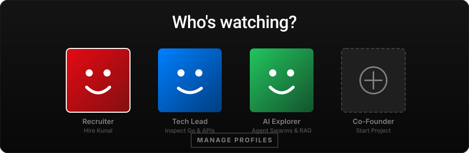

<div align="center">

  <!-- ============================================== -->
  <!-- 🍿 NETFLIX ORIGINAL BILLBOARD HERO             -->
  <!-- ============================================== -->
  <a href="https://kunalchauhan-dev.vercel.app/" target="_blank">
    
  </a>

  <br><br>

  <!-- Netflix Billboard Action Buttons -->
  <p align="center">
    <a href="https://kunalchauhan-dev.vercel.app/" target="_blank">
      
    </a>
    &nbsp;&nbsp;
    <a href="#-top-10-in-tech-today-global-trending-catalog">
      
    </a>
  </p>

  <!-- Netflix Dynamic Stream Tagline -->
  <a href="https://kunalchauhan-dev.vercel.app/" target="_blank">
    
  </a>

  <br><br>

  <!-- Netflix Badges Bar -->
  <p align="center">
    <a href="https://kunalchauhan-dev.vercel.app/" target="_blank">
      
    </a>
    &nbsp;
    <a href="https://komarev.com/ghpvc/?username=burgerbeast7">
      
    </a>
    &nbsp;
    <a href="https://linkedin.com/in/kunal-chauhan-7a7539287" target="_blank">
      
    </a>
    &nbsp;
    <a href="mailto:kunalchauhan91837@gmail.com">
      
    </a>
    &nbsp;
    <a href="https://instagram.com/Kunal.3.6.3.4" target="_blank">
      
    </a>
  </p>

</div>

<p align="center">
  
</p>

<!-- ============================================== -->
<!-- 👤 WHO'S WATCHING? (NETFLIX PROFILE PICKER)    -->
<!-- ============================================== -->
<div align="center">
  
</div>

<br>

<div align="center">
  <p>
    <b>SELECT A PROFILE TO BEGIN STREAMING:</b><br>
    🔴 <b>Recruiter Profile:</b> Stream interactive demos &amp; case studies on the <a href="https://kunalchauhan-dev.vercel.app/" target="_blank"><b>Official Portfolio (kunalchauhan-dev.vercel.app)</b></a>.<br>
    🔵 <b>Tech Lead Profile:</b> Inspect microsecond <a href="https://github.com/burgerbeast7/ATLAS">Golang Concurrency</a> and API architecture.<br>
    🟢 <b>AI Explorer Profile:</b> Binge <a href="https://github.com/burgerbeast7/careerpilot-ai">Agentic Multi-Agent LangGraph Swarms</a>.<br>
    ⚪ <b>Co-Producer Profile:</b> Jump to the <a href="#-ready-to-watch-start-your-collaboration">Contact Section</a> to greenlight a project.
  </p>
</div>

<p align="center">
  
</p>

<!-- ============================================== -->
<!-- 🏆 TOP 10 IN TECH TODAY (FEATURED TITLES)      -->
<!-- ============================================== -->
### 🔥 Top 10 in Tech Today (Global Trending Catalog)

<p><i>The most-watched repositories in Kunal's catalog, ranked by engineering complexity and runtime performance:</i></p>

<table>
  <tr>
    <td width="50%" valign="top">
      <h3 align="center">🥇 #1 in Trending: CareerPilot AI</h3>
      <p align="center">
        <a href="https://github.com/burgerbeast7/careerpilot-ai">
          
        </a>
      </p>
      <p>
        <b style="color: #46D369;">99% Match</b> • <b>TV-MA (Agentic Swarms)</b> • <b>1 Season (Production Ready)</b> • <b>4K UHD</b><br>
        <b>Logline:</b> <i>When 90% of resumes vanish into ATS filters, an autonomous multi-agent swarm steps into the spotlight.</i><br>
        Features semantic RAG resume intelligence, automated gap analysis, and interactive mock interview coaching.
      </p>
      <p>
        <code>TypeScript</code> • <code>React</code> • <code>FastAPI</code> • <code>LangGraph</code> • <code>RAG</code>
      </p>
    </td>
    <td width="50%" valign="top">
      <h3 align="center">🥈 #2 in Machine Learning: ModelBench AI</h3>
      <p align="center">
        <a href="https://github.com/burgerbeast7/ModelBench-AI">
          
        </a>
      </p>
      <p>
        <b style="color: #46D369;">98% Match</b> • <b>TV-14 (Model Arena)</b> • <b>Studio Edition</b> • <b>Ultra HD</b><br>
        <b>Logline:</b> <i>Ending the chaotic era of messy Jupyter notebooks and manual spreadsheet tracking.</i><br>
        A studio-grade benchmarking arena comparing classification and regression models side-by-side with interactive metric dashboards and reusable ML pipelines.
      </p>
      <p>
        <code>Python</code> • <code>Machine Learning</code> • <code>Scikit-Learn</code> • <code>Data Pipelines</code>
      </p>
    </td>
  </tr>
  <tr>
    <td width="50%" valign="top">
      <h3 align="center">🥉 #3 in High Concurrency: ATLAS Engine</h3>
      <p align="center">
        <a href="https://github.com/burgerbeast7/ATLAS">
          
        </a>
      </p>
      <p>
        <b style="color: #46D369;">99% Match</b> • <b>TV-MA (Extreme QPS)</b> • <b>Microsecond Latency</b> • <b>Dolby Audio</b><br>
        <b>Logline:</b> <i>When raw speed matters, Go's goroutines deliver pure computational adrenaline.</i><br>
        Engineered with Golang lightweight concurrency channels and zero-allocation pipelines to handle intense workloads with microsecond latency.
      </p>
      <p>
        <code>Go (Golang)</code> • <code>Concurrency</code> • <code>High Performance</code> • <code>Systems Design</code>
      </p>
    </td>
    <td width="50%" valign="top">
      <h3 align="center">🎬 #4 in Enterprise Thrillers: Greyquill Entity Resolution</h3>
      <p align="center">
        <a href="https://github.com/burgerbeast7/greyquill-entity-resolution">
          
        </a>
      </p>
      <p>
        <b style="color: #46D369;">97% Match</b> • <b>TV-PG (Data Hygiene)</b> • <b>Explainable Algorithms</b><br>
        <b>Logline:</b> <i>Untangling enterprise customer chaos without resorting to unexplainable black-box AI.</i><br>
        Custom record-linkage algorithms with explainable similarity scoring to detect duplicate records across noisy real-world customer datasets.
      </p>
      <p>
        <code>Python</code> • <code>Record Linkage</code> • <code>Similarity Scoring</code> • <code>Data Hygiene</code>
      </p>
    </td>
  </tr>
  <tr>
    <td width="50%" valign="top">
      <h3 align="center">🎬 #5 in Smart City Drama: SmartPark AI</h3>
      <p align="center">
        <a href="https://github.com/burgerbeast7/SmartPark-AI">
          
        </a>
      </p>
      <p>
        <b style="color: #46D369;">96% Match</b> • <b>TV-G (Urban Mobility)</b> • <b>Real-Time Telemetry</b><br>
        <b>Logline:</b> <i>A modern thriller: 20 minutes spent circling a packed parking lot, solved in seconds.</i><br>
        Cross-platform mobile client featuring real-time bay occupancy telemetry, cloud synchronization, and automated slot reservations.
      </p>
      <p>
        <code>Dart</code> • <code>Flutter</code> • <code>TypeScript</code> • <code>Mobile Cloud APIs</code>
      </p>
    </td>
    <td width="50%" valign="top">
      <h3 align="center">🎬 #6 in Campus Saga: HPTU Assistant (ASIST)</h3>
      <p align="center">
        <a href="https://github.com/burgerbeast7/HPTU-ASIST">
          
        </a>
      </p>
      <p>
        <b style="color: #46D369;">98% Match</b> • <b>TV-PG (Student Life)</b> • <b>4 Seasons Archive</b><br>
        <b>Logline:</b> <i>The definitive survival series for college students staring down finals week.</i><br>
        Centralized portal for students at HPTU Hamirpur to access syllabus syllabi, semester notes, academic notifications, and utility calculators.
      </p>
      <p>
        <code>Python</code> • <code>Full-Stack</code> • <code>Campus Utilities</code> • <code>Student Tooling</code>
      </p>
    </td>
  </tr>
</table>

<br>
<p align="center">
  
</p>

<!-- ============================================== -->
<!-- 📺 CONTINUE WATCHING (TECH STACK & GENRES)     -->
<!-- ============================================== -->
### 🍿 Continue Watching for Kunal (Tech Genres &amp; Arsenal)

<div align="center">

| Netflix Genre | Starring Technologies |
| :--- | :--- |
| **🎬 Critically Acclaimed Languages** | `Python 3.12` `Go (Golang)` `TypeScript` `JavaScript` `Dart` `C` `C++` `SQL` |
| **🤖 Sci-Fi &amp; Neural Intelligence** | `LangGraph` `Multi-Agent Swarms` `RAG Workflows` `PyTorch` `Vector DBs` |
| **✨ Binge-Worthy Frontend Dramas** | `React 19` `Next.js` `Redux Toolkit` `TailwindCSS` `Framer Motion` `Vite` |
| **⚡ High-Adrenaline Backends &amp; APIs** | `FastAPI (ASGI)` `Go Channels` `Django` `Node.js` `WebSockets` `Redis` |
| **💾 Data Vaults &amp; Architecture** | `PostgreSQL` `MongoDB` `Redis Cache` `SQLite` `Prisma ORM` |
| **🛡️ Production &amp; Cloud Armor** | `Docker Containers` `AWS (EC2, S3)` `Linux (Bash)` `GitHub Actions CI/CD` |

<br>

<!-- Netflix Dark Skill Matrix Ribbon -->
<a href="https://skillicons.dev">
  
</a>

</div>

<br>
<p align="center">
  
</p>

<!-- ============================================== -->
<!-- 🎞️ SEASONS & EPISODES (DEVELOPER TIMELINE)     -->
<!-- ============================================== -->
### 🎞️ Production Timeline: Seasons &amp; Episodes Guide

```text
Season 1: The Pilot & Foundations (2022 - 2023)
├── Ep 1: "Hello World" — Mastering C/C++, Memory Structures & Computational Logic.
└── Ep 2: "Deep Roots" — Object-Oriented Principles, Linux Kernels & Algorithmic Grit.

Season 2: The Full-Stack Arc (2023 - 2024)
├── Ep 3: "Reactive Realities" — Building first responsive UIs with React and REST backends.
└── Ep 4: "Database Chronicles" — PostgreSQL normalization, Python microservices & Docker.

Season 3: High Concurrency & The Agentic Breakthrough (2024 - 2025)
├── Ep 5: "Go Fast" — Discovering Golang goroutines, microsecond pipelines & systems engineering.
└── Ep 6: "Rise of the Agents" — Pioneering autonomous multi-agent swarms with LangGraph.

Season 4: The Season Finale (2025 - 2026) [CURRENTLY STREAMING]
├── Ep 7: "The Final Defense" — Final Year B.Tech CSE @ HPTU Hamirpur & Shipping CareerPilot AI.
└── Ep 8: "The Next Franchise" — Open to visionary full-time Software Engineering & AI roles.
```

<br>
<p align="center">
  
</p>

<!-- ============================================== -->
<!-- 📈 STREAM TELEMETRY & RATINGS                  -->
<!-- ============================================== -->
### 📊 Critics &amp; Audience Ratings (Global Telemetry)

<div align="center">

  <!-- Main GitHub Stats & Streak Stats in Netflix Colors -->
  <p align="center">
    
    &nbsp;
    
  </p>

  <!-- Top Languages Compact in Netflix Colors -->
  <p align="center">
    
  </p>

  <br>

  <!-- Dev Quote Card in Netflix Colors -->
  

</div>

<br>
<p align="center">
  
</p>

<!-- ============================================== -->
<!-- ❓ FREQUENTLY ASKED QUESTIONS (NETFLIX ACCORDION)-->
<!-- ============================================== -->
### ❓ Frequently Asked Questions

<details>
  <summary><b>▶ What is Kunal Chauhan?</b></summary>
  <br>
  <p>Kunal is a final-year Computer Science &amp; Engineering undergrad at <b>HPTU Hamirpur</b>, specializing in architecting <b>Agentic AI systems (LangGraph)</b>, high-concurrency backends in <b>Go &amp; FastAPI</b>, and fluid user interfaces in <b>React &amp; TypeScript</b>.</p>
</details>

<details>
  <summary><b>▶ Where can I watch his live portfolio and projects in action?</b></summary>
  <br>
  <p>Stream interactive live deployments, full-stack case studies, and responsive design systems directly on his official portfolio: <b><a href="https://kunalchauhan-dev.vercel.app/" target="_blank">kunalchauhan-dev.vercel.app</a></b>! All underlying production code is open-sourced across the repositories in this catalog.</p>
</details>

<details>
  <summary><b>▶ How much does it cost to subscribe / hire Kunal?</b></summary>
  <br>
  <p>Zero subscription fees. Available for high-impact full-time software engineering roles, internships, and collaborative builds with teams pushing the boundaries of AI and scalable systems.</p>
</details>

<details>
  <summary><b>▶ What devices and platforms are supported?</b></summary>
  <br>
  <p>Cross-platform compatibility across Chrome, Safari, Firefox, Linux CLI, Docker containers, and macOS / Windows workstations.</p>
</details>

<details>
  <summary><b>▶ Can I binge-watch his previous repositories?</b></summary>
  <br>
  <p>Absolutely. Scroll up to the <a href="#-top-10-in-tech-today-global-trending-catalog">Top 10 Trending Titles</a> to explore all flagship repositories.</p>
</details>

<br><br>

<!-- ============================================== -->
<!-- 🎬 READY TO WATCH? (NETFLIX CTA FOOTER)        -->
<!-- ============================================== -->
<div align="center">

  <h3>Ready to start streaming?</h3>
  <p>Stream his live interactive portfolio or enter an inquiry to greenlight a collaboration.</p>

  <p align="center">
    <a href="https://kunalchauhan-dev.vercel.app/" target="_blank">
      
    </a>
    &nbsp;&nbsp;
    <a href="https://linkedin.com/in/kunal-chauhan-7a7539287" target="_blank">
      
    </a>
    &nbsp;&nbsp;
    <a href="mailto:kunalchauhan91837@gmail.com">
      
    </a>
    &nbsp;&nbsp;
    <a href="https://instagram.com/Kunal.3.6.3.4" target="_blank">
      
    </a>
  </p>

  <br>
  <p align="center">
    <a href="https://kunalchauhan-dev.vercel.app/" target="_blank">
      
    </a><br>
    <small style="color: #737373;">
      <a href="https://kunalchauhan-dev.vercel.app/" target="_blank" style="color: #E50914; font-weight: bold; text-decoration: none;">kunalchauhan-dev.vercel.app</a><br>
      KC Logo are trademarks of KunalChauhan, Inc. This profile is a creative developer tribute portfolio.<br>
      © 2026 Kunal Chauhan (@burgerbeast7) • Palampur, Himachal Pradesh.
    </small>
  </p>

</div>
