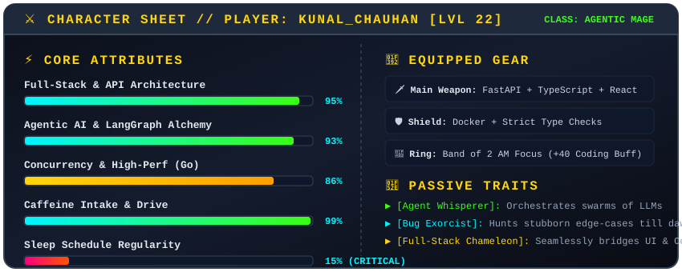

  <!-- ========================================== -->
  <!-- 🕹️ RETRO PIXEL CYBERPUNK TERMINAL HEADER   -->
  <!-- ========================================== -->
  

    

  <!-- Animated Real-Human Dynamic Typing Tagline -->
  

   

  <!-- Arcade Badges & Coordinates -->
  

    
    &nbsp;
    
    &nbsp;
    
    &nbsp;
    
    &nbsp;
    
  

  

<!-- ========================================== -->
<!-- 👾 HUMAN INTRO // MEET THE CODER           -->
<!-- ========================================== -->
### 👾 Who Am I? (The Unfiltered Human Version)

> *"Why do something manually in 5 minutes when you can spend 6 uninterrupted hours passionately building an automated system to do it for you?"*

Hey! I’m **Kunal Chauhan** — a final-year Computer Science undergrad at **HPTU Hamirpur**, an **Agentic AI explorer**, and an unapologetic night-owl builder. 

Most developer profiles sound like they were drafted by a corporate HR committee. Here’s the real deal:
- 💡 **I get genuinely obsessed with how things tick under the hood.** Whether it's chaining multi-agent LLM workflows with **LangGraph**, crafting lightning-fast concurrent microservices in **Go**, or obsessing over 60fps micro-interactions in **React**, I build software that has real craft and soul behind it.
- 🛠️ **I don't just write scripts; I build end-to-end products.** From the database schema and Docker containers to the frontend animations and API resilience.
- 🏔️ **Operating out of Palampur (Himachal Pradesh)** — where cold mountain air meets hot espresso and frantic late-night terminal sessions.

---

<!-- ========================================== -->
<!-- ⚔️ RETRO RPG CHARACTER PROFILE             -->
<!-- ========================================== -->

  

 

<!-- ========================================== -->
<!-- 🕹️ INTERACTIVE QUESTS & EASTER EGGS       -->
<!-- ========================================== -->

  
<b>🍔 [CLICK TO REVEAL] Why the name <code>@burgerbeast7</code>?</b>

   
  <blockquote>
    
Everyone asks where the handle came from! The philosophy is simple: <b>great software is built exactly like a world-class gourmet burger:</b>

    <ul>
      <li>🍞 <b>Top Bun:</b> Slick, buttery-smooth React &amp; Next.js interfaces that feel delightful to touch.</li>
      <li>🥬 <b>Fresh Greens:</b> Clean, readable, modular code that doesn't rot after 2 weeks.</li>
      <li>🧀 <b>Melted Cheese:</b> Seamless API communication layers (FastAPI + WebSockets) binding everything together.</li>
      <li>🥩 <b>The Prime Patty:</b> High-performance, concurrent backend engines (Go &amp; Python) doing the heavy lifting.</li>
      <li>🌶️ <b>The Secret Sauce:</b> Autonomous Agentic AI &amp; LangGraph pipelines that make regular apps feel magical.</li>
      <li>🍞 <b>Bottom Bun:</b> Rock-solid Docker containers and AWS cloud infrastructure keeping the whole stack from collapsing.</li>
    </ul>
    
And the <b>7</b>? The lucky prime number, naturally.

  </blockquote>

  
<b>🎧 [CLICK TO EXPAND] 2 AM Coding Fuel &amp; Soundtrack</b>

   
  <pre>
┌────────────────────────────────────────────────────────────────────────┐
│  🎵 NOW PLAYING: "Synthwave Coding Marathon // 02:42 AM"               │
│  ◄◄  [ ▶ PLAYING ]  ►►   ═════════════════════════●─── 02:42 / 04:20    │
│                                                                        │
│  ☕ FUEL CONSUMED: 3x French Press Espresso                            │
│  🎧 ROTATION: Synthwave • Lofi Chillhop • Cyberpunk 2077 OST • Phonk   │
│  🧠 MENTAL STATE: Transcendence (Or extreme sleep deprivation)        │
└────────────────────────────────────────────────────────────────────────┘
  </pre>

  
<b>🐛 [CLICK TO REVEAL] True Dev Confessions &amp; Funny Debug Logs</b>

   
  <ul>
    <li><i>"If code works on the very first try, I don't celebrate. I get suspicious and spend 45 minutes investigating what silent failure I accidentally swallowed."</i></li>
    <li><i>"There are two types of hard problems in Computer Science: cache invalidation, naming things, and off-by-one errors."</i></li>
    <li><i>"My Git commit history at 2 PM: 'Feat: Add robust vector search with fallback'. My Git commit history at 3:30 AM: 'please work for the love of god'."</i></li>
  </ul>

 

  

<!-- ========================================== -->
<!-- 🛠️ BATTLE-TESTED WEAPONS & INVENTORY      -->
<!-- ========================================== -->
### 🛠️ The Tech Arsenal (What I Actually Build With)

| Class | Arsenal |
| :--- | :--- |
| **Languages** | `Python` `TypeScript` `JavaScript` `Go (Golang)` `Dart` `C` `C++` `SQL` |
| **AI &amp; Agentic Systems** | `LangGraph` `LangChain` `Multi-Agent Orchestration` `RAG Pipelines` `PyTorch` `Scikit-Learn` |
| **Frontend Sorcery** | `React` `Next.js` `Redux Toolkit` `TailwindCSS` `Vite` `Framer Motion` |
| **Backend &amp; High-Speed APIs** | `FastAPI` `Django` `Node.js` `Express` `RESTful APIs` `WebSockets` |
| **Data Vaults &amp; Cache** | `PostgreSQL` `MongoDB` `Redis` `SQLite` `Vector DBs` |
| **DevOps &amp; Cloud Armor** | `Docker` `AWS (S3, EC2)` `Linux (Bash)` `GitHub Actions` `Postman` |

 

<!-- Animated Skill Ribbons -->

 

  

<!-- ========================================== -->
<!-- 🚀 BOSS FIGHTS & EPIC QUESTS (PROJECTS)    -->
<!-- ========================================== -->
### 🚀 Boss Fights Won (Featured Projects)

<i>Every project here was built to solve an actual headache or explore bleeding-edge territory:</i>

<table>
  <tr>
    <td width="50%" valign="top">
      <h3 align="center">🤖 CareerPilot AI</h3>
      

        
      

      

        <b>Quest: Slaying the ATS Black Hole ⚔️</b> 
        Recruiters toss resumes into automated ATS filters that ghost 90% of applicants. Built an enterprise-grade <b>autonomous agent swarm</b> that tears through your resume, performs semantic gap analysis against live job descriptions, conducts dynamic voice/text mock interviews, and crafts personalized study roadmaps.
      

      

        <code>TypeScript</code> • <code>React</code> • <code>FastAPI</code> • <code>LangGraph</code> • <code>RAG</code>
      

    </td>
    <td width="50%" valign="top">
      <h3 align="center">📊 ModelBench AI</h3>
      

        
      

      

        <b>Quest: Ending the Jupyter Notebook Chaos 🧪</b> 
        Tired of running 12 separate notebooks and copy-pasting accuracy scores into spreadsheets to see which model wins? Built an arena-style ML benchmarking platform that pits classification and regression models head-to-head with interactive metric dashboards and reusable pipelines.
      

      

        <code>Python</code> • <code>Machine Learning</code> • <code>Scikit-Learn</code> • <code>Data Pipelines</code>
      

    </td>
  </tr>
  <tr>
    <td width="50%" valign="top">
      <h3 align="center">⚡ ATLAS</h3>
      

        
      

      

        <b>Quest: Concurrency &amp; Raw Velocity 🏎️</b> 
        Falling deep into Golang's concurrency model. Engineered a high-throughput backend architecture utilizing lightweight goroutines and channels to handle compute-heavy operations with near-zero overhead and bulletproof error boundaries.
      

      

        <code>Go (Golang)</code> • <code>Concurrency</code> • <code>High Performance</code> • <code>System Architecture</code>
      

    </td>
    <td width="50%" valign="top">
      <h3 align="center">🔍 Greyquill Entity Resolution</h3>
      

        
      

      

        <b>Quest: Deduplicating Real-World Customer Chaos 🧼</b> 
        Real enterprise datasets are messy: typos, transposed phone numbers, swapped names. Built an explainable record-linkage system with similarity scoring algorithms that flags duplicate entities without operating as an unexplainable black box.
      

      

        <code>Python</code> • <code>Record Linkage</code> • <code>Similarity Scoring</code> • <code>Data Hygiene</code>
      

    </td>
  </tr>
  <tr>
    <td width="50%" valign="top">
      <h3 align="center">🚗 SmartPark AI</h3>
      

        
      

      

        <b>Quest: Eradicating the 20-Minute Parking Hunt 🅿️</b> 
        Because circling a parking lot for half an hour makes everyone question life choices. Cross-platform mobile reservation and occupancy tracking system for real-time space booking and seamless vehicle access.
      

      

        <code>Dart</code> • <code>Flutter</code> • <code>TypeScript</code> • <code>Mobile Cloud APIs</code>
      

    </td>
    <td width="50%" valign="top">
      <h3 align="center">🎓 HPTU Assistant (ASIST)</h3>
      

        
      

      

        <b>Quest: University Survival Made Easy 🎒</b> 
        Built specifically for fellow students at HPTU Hamirpur to navigate exam seasons without panicking. Centralizes syllabus syllabi, semester notes, academic notifications, and utility calculators into one unified portal.
      

      

        <code>Python</code> • <code>Campus Utilities</code> • <code>Full-Stack</code> • <code>Student Tooling</code>
      

    </td>
  </tr>
</table>

 

  

<!-- ========================================== -->
<!-- 📈 LIVE ARCADE STATS & TELEMETRY           -->
<!-- ========================================== -->
### 📈 Live Telemetry & GitHub Arcade

  <!-- Main GitHub Stats & Streak Stats -->
  

    
    &nbsp;
    
  

  <!-- Most Used Languages Compact -->
  

    
  

   

  <!-- Random Dev Quote -->
  

 

  

<!-- ========================================== -->
<!-- 🤝 CO-OP MULTIPLAYER (CONNECT)             -->
<!-- ========================================== -->
### 🤝 Ready to Play Co-Op? (Let's Build Something Crazy)

  Whether you have an ambitious AI project, want to geek out over Go goroutines, or have an exciting engineering role — my DMs and inbox are always open!

  
  &nbsp;&nbsp;
  
  &nbsp;&nbsp;
  

 

  

    <code>[ SYSTEM SHUTDOWN: STANDBY MODE ]</code> 
    <i>Crafted with pure adrenaline, coffee &amp; code by <b>Kunal Chauhan (@burgerbeast7)</b></i> 
    ⭐️ <b>Press ★ on your favorite repo if you enjoyed the tour!</b>
  

